# Stock Chart App

A self-hosted stock research workspace for your Charles Schwab account. Review portfolio performance, investigate scanner candidates, compare price charts, follow financial news, and organize market research in one browser interface.

This guide follows the order you will use the project: **set it up → explore the pages → understand the system → maintain and publish it**. The application includes experimental trading and research components; the setup below keeps live order submission disabled.

This is an independent project, not an official Schwab application.

## Contents

1. [Implementation and first launch](#1-implementation-and-first-launch)
   - [Prerequisites](#11-prerequisites)
   - [Schwab account and developer app](#12-schwab-account-and-developer-app)
   - [Configuration](#13-create-local-configuration)
   - [HTTPS certificates](#14-create-local-https-certificates)
   - [Start the core services](#15-start-the-core-services)
   - [Authorize and start workers](#16-authorize-and-start-workers)
   - [Verify the installation](#17-verify-the-installation)
2. [Page-by-page guide](#2-page-by-page-guide)
   - [Dashboard](#21-dashboard)
   - [Scanner](#22-scanner)
   - [Chart workspace](#23-chart-workspace)
   - [Calendar](#24-calendar)
   - [News feed](#25-news-feed)
   - [News LLM](#26-news-llm)
   - [Research / RL Models](#27-research--rl-models)
   - [Settings](#28-settings)
   - [Profile](#29-profile)
3. [How the system works](#3-how-the-system-works)
   - [Architecture](#31-architecture)
   - [Authentication and account access](#32-authentication-and-account-access)
   - [Market data and scanner decisions](#33-market-data-and-scanner-decisions)
   - [News ingestion and analysis](#34-news-ingestion-and-analysis)
   - [Storage and persistence](#35-storage-and-persistence)
   - [Research and trading boundaries](#36-research-and-trading-boundaries)
   - [Services and deployment options](#37-services-and-deployment-options)
4. [Operation, development, and publication](#4-operation-development-and-publication)
   - [Service commands](#41-service-commands)
   - [Configuration reference](#42-configuration-reference)
   - [Development and testing](#43-development-and-testing)
   - [Troubleshooting](#44-troubleshooting)
   - [Publishing safely](#45-publishing-safely-on-github)
   - [Further documentation](#46-further-documentation)

## 1. Implementation and first launch

These instructions use the standalone starter stack. It has separate credentials, ports, and storage from any existing installation. The public package does not contain the author's working environment, private operational notes, or machine-specific Compose configuration.

### 1.1 Prerequisites

- Docker Engine/Desktop with Docker Compose v2, Python 3.12, and OpenSSL.
- Your own approved Schwab developer app for account access.
- Disk space and memory for PostgreSQL, Redis, Neo4j, Qdrant, and the backend dependencies. No GPU is required by the starter configuration, but the dependency image is substantial.
- Node.js 22 and npm if developing the frontend outside Docker.

Commands use a POSIX shell (Linux, macOS, or WSL). Run them from this README's directory. Never run setup against an existing directory unless you intend to use that copy; the initializer refuses to overwrite `.starter`.

### 1.2 Schwab account and developer app

Use your own eligible self-directed Schwab account. If needed, begin at [Schwab's brokerage account page](https://www.schwab.com/brokerage) and complete its application and identity-verification steps on Schwab's site.

Register through the [Schwab Developer Portal](https://developer.schwab.com/), choose the individual developer profile, and request [Trader API – Individual](https://developer.schwab.com/products/trader-api--individual) access. Follow the current portal's agreements and approval steps, then [create your developer app](https://developer.schwab.com/user-guides/apis-and-apps/create-an-app).

Register this exact starter callback:

```text
https://127.0.0.1:18443/auth/callback
```

Keep your app key and secret private. If another installation already uses a different callback, use a separate developer app or carefully manage its allowed callbacks without replacing the existing configuration. Portal labels and approval timing can change; follow the [official guides](https://developer.schwab.com/user-guides).

### 1.3 Create local configuration

```bash
python3 scripts/check-starter.py --init
```

This creates a new `.starter/` directory with a public environment template, a generated encryption key, and local TLS files. It does not read or alter another installation's credentials. Edit `.starter/backend.env` to supply your own `SCHWAB_CLIENT_ID` and `SCHWAB_CLIENT_SECRET`. Leave live execution disabled; the starter Compose file also forces submission gates off and the kill switch on.

The command refuses if `.starter` already exists. Keep its encryption key across restarts so stored tokens remain readable. Do not commit any files from `.starter`.

### 1.4 Create local HTTPS certificates

Initialization already generated `.starter/certs/server.crt` and `server.key`. Trust the certificate through your local OS/browser workflow, or supply certificates issued by your own trusted local development authority in this separate directory. Never publish the private key.

Run the read-only pre-start checker:

```bash
python3 scripts/check-starter.py
```

It checks tool availability, required configuration, key format, certificate compatibility/expiry, ports, and Compose syntax without printing credentials or starting containers. Port checks are intended before startup. Do not disable certificate validation globally.

### 1.5 Start the core services

```bash
docker compose --env-file /dev/null -p stockapp-starter -f compose.starter.yaml up -d --build
```

The explicit file and project name isolate the starter from other Compose installations. Only the frontend and API publish ports, both on loopback. Database, cache, graph, and vector services remain on the container network. Named volumes are private to the starter project.

| Address | Purpose |
| --- | --- |
| `https://127.0.0.1:13000` | Browser application |
| `https://127.0.0.1:18443/healthz` | API liveness |
| `https://127.0.0.1:18443/docs` | API reference |

First builds may take time to install the backend's data/model libraries. Development database credentials and graph settings are for local use; this is not an internet-hosting recipe.

### 1.6 Authorize and start workers

Open `https://127.0.0.1:13000`, complete Schwab login/consent on its official domain, and return through the callback. Use `127.0.0.1` consistently. A callback URL after login may contain a temporary code; never share it.

Once Dashboard and Profile load, optionally start the scanner and account-stream workers:

```bash
docker compose --env-file /dev/null -p stockapp-starter -f compose.starter.yaml --profile scanner up -d --build
```

Authorization and provider permissions determine what those workers can access. This profile does not start order-submission workers, historical jobs, or news/model services.

### 1.7 Verify the installation

Check container health, Dashboard account data, Profile session status, and Settings loading/saving. A new account may have no positions or completed trades. Fresh scanner results require worker access and candidates that pass your filters.

News/model/history panels can be empty because the starter does not run those pipelines. The source includes the advanced components, but configuring them requires additional services, data, and resources. See the [starter guide](docs/starter-setup.md) and [source guide](docs/system-guide.md).

## 2. Page-by-page guide

Begin with Dashboard and Profile to confirm the connection. Set your filters in Settings, investigate a candidate in Scanner, and open its charts. News and Calendar provide context; News LLM and Research expose the supporting analysis and data workflows.

> The screenshots show the actual frontend using synthetic browser fixtures. All balances, trades, prices, headlines, and worker statistics are illustrative. No brokerage account was connected for these captures. `DEMO` and `SAMPLE` are fictional screenshot symbols.

### 2.1 Dashboard

**Route:** `/dashboard` · **Purpose:** understand your account and current operating state.

The account cards show equity, cash, daily P/L, and realized/unrealized P/L. Open positions show current exposure, while recent closed trades and entry-price performance buckets help review completed activity. Market-index cards provide a broader market reference.

Use **Refresh** for an immediate update or enable periodic refresh. Check the Auto Trader control and worker status together: the switch and the worker heartbeat communicate different things. A fresh heartbeat indicates that a worker reported recently; it does not establish that orders were placed or that the strategy is effective.

The page depends on Schwab authorization and account data. An account without positions or completed trade pairs can legitimately show empty tables. The Auto Trader switch has credential-retention implications described in [Research and trading boundaries](#36-research-and-trading-boundaries).

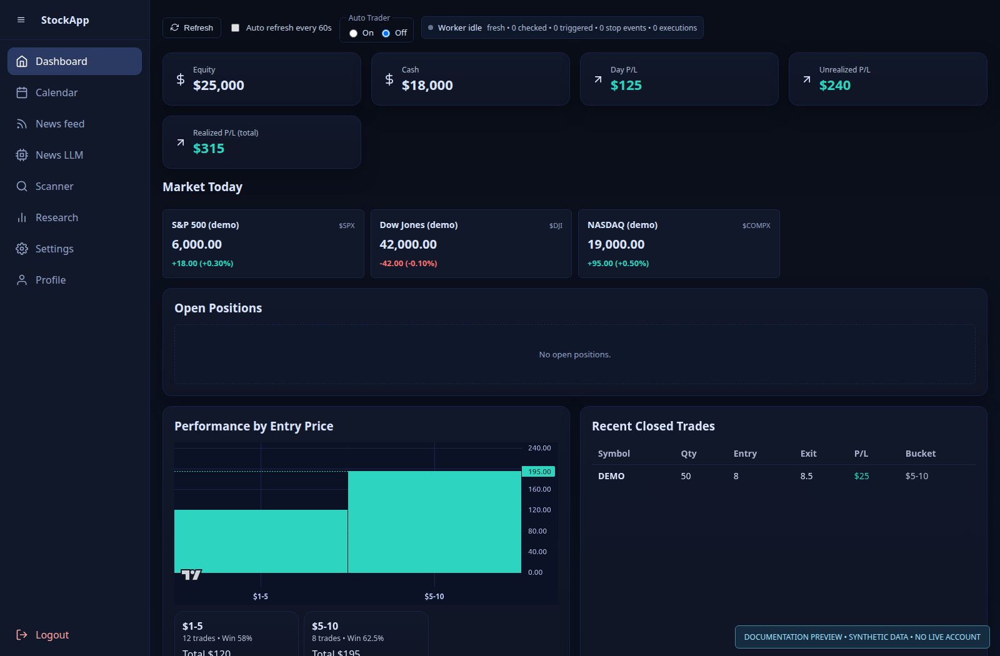

### 2.2 Scanner

**Route:** `/scanner` · **Purpose:** narrow the market to candidates worth investigating.

The scanner groups results into actionable, priority, higher-float, lower-volume, and too-expensive watchlists. Rows bring together quote data, daily movement, relative volume, available float information, technical signals, catalyst context, and sentiment. These categories reflect the configured rules and available evidence.

1. Review the worker status and quote freshness.
2. Adjust price, volume, float, and scan-interval settings when needed.
3. Select a symbol to inspect its decision details and supporting context.
4. Open its chart to compare the signal against price action and news timing.

Relative volume (RVOL) compares trading activity with a reference baseline. Float describes shares available for public trading when evidence is available; missing float is not zero. An actionable label or confidence score is a research output, not an executed order or a calibrated probability of profit.

Results depend on the scanner worker, market access, saved settings, and the available news/company data. Restrictive filters or missing inputs can produce no candidates.

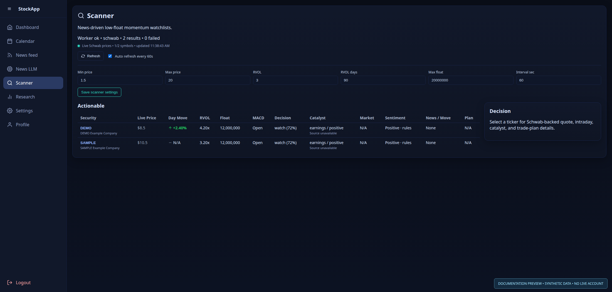

### 2.3 Chart workspace

**Route:** `/charts/:symbol`, for example `/charts/AAPL` · **Purpose:** inspect one symbol across timeframes.

The workspace displays 1-minute, 5-minute, hourly, and daily charts. Hourly candles are aggregated from Schwab 30-minute bars. Use the symbol field to change securities and each chart's range selector to change the historical window. Refresh controls update the displayed data.

| Display | What it helps you inspect |
| --- | --- |
| Candlesticks | Open, high, low, and closing prices for each interval |
| Volume | Trading activity behind price movement |
| VWAP | Volume-weighted average price for the applicable series/session |
| MACD and signal | Momentum measures derived from moving averages |
| News markers and article links | Timing of coverage relative to the price series |
| Company context and latest quote | Identity and current reference price of the selected symbol |

Compare the short-term charts with the daily chart, then open source articles to assess the context. News appearing near a price move does not establish that it caused the move. History depth and freshness depend on Schwab's available data and the requested interval.

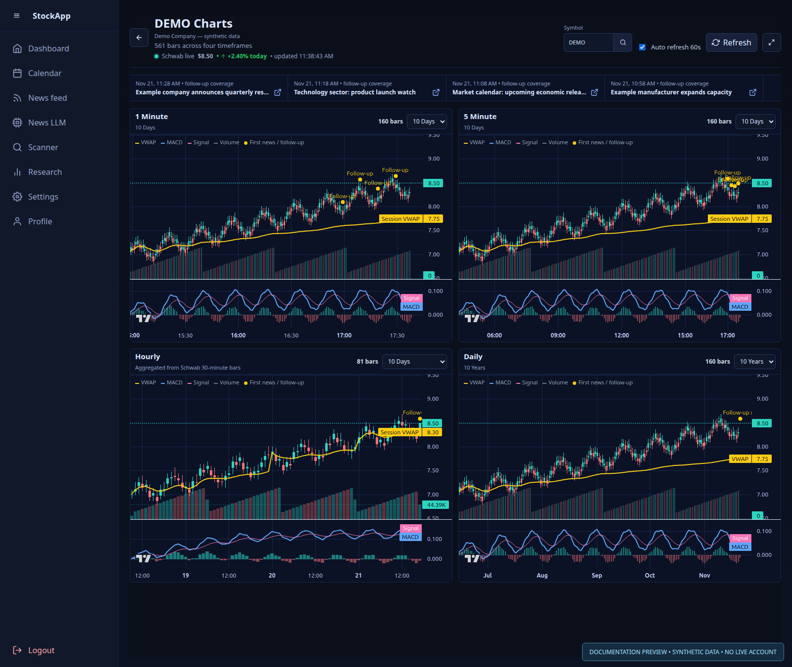

### 2.4 Calendar

**Route:** `/calendar` · **Purpose:** connect activity, market events, and your own review process.

Navigate between months, filter by symbol, and select a day to examine its trading/news context. Daily and monthly summaries help review completed activity. Planning entries and daily reviews let you record what you intended to do and what you learned afterward.

Calendar state supports saving, import/export, and review archives. Earnings and IPO integrations add event context when their workers are available. Imported or generated events should be checked against their source before being used for planning.

The page combines portfolio data, retained news/events, and saved review state. PostgreSQL provides durable calendar persistence when configured; the frontend also maintains local calendar state. Exported calendars can contain private notes and trading information, so keep real exports out of the public repository.

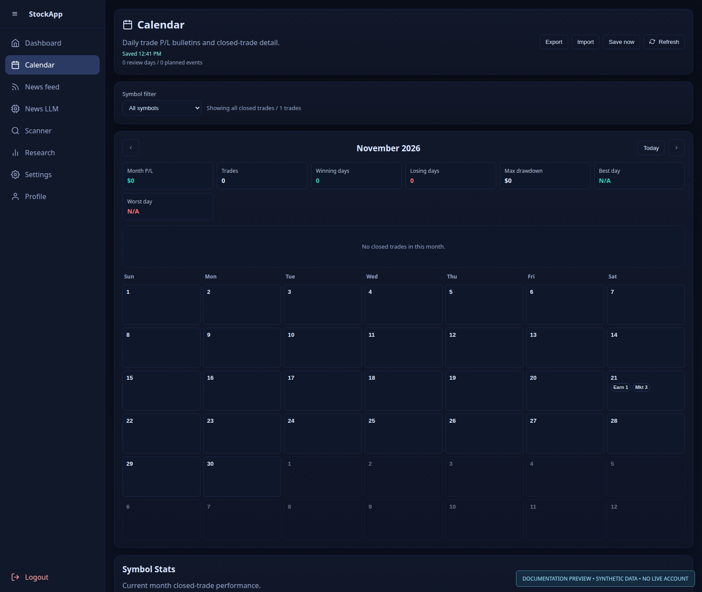

### 2.5 News feed

**Route:** `/news` · **Purpose:** read current coverage and investigate historical events.

| View | How to use it |
| --- | --- |
| Latest | Browse recent headlines, summaries, sources, provider attribution, and ticker links; adjust age/sort and refresh controls |
| Historical Events | Search the separately indexed GDELT event collection and inspect related coverage |
| Review Queue | Inspect flagged quality issues and record review decisions |

Open the publisher link to read the underlying coverage. If an extracted headline appears questionable, flag it for review. Similar provider entries may be consolidated into one article while retaining attribution.

A GDELT event and a publisher article are different records: the event index is not simply an older copy of the Latest feed. Fresh articles require ingestion; historical search requires a populated event index. Missing enrichment can leave an article pending analysis without preventing it from appearing in the feed.

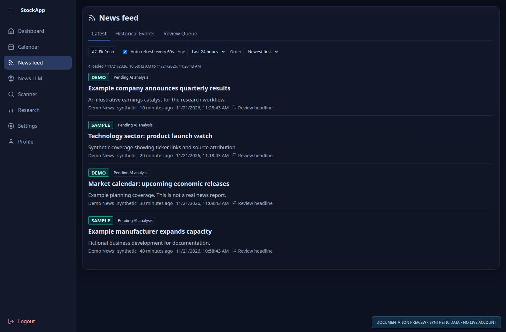

### 2.6 News LLM

**Route:** `/news-llm` · **Purpose:** configure and inspect the models that process news.

This page exposes model/server status, catalog search, model installation and selection, article previews, processing controls, queue progress, and quality review. It also provides controls for the separate financial-sentiment service and its evaluation tools.

A typical setup is to start the required model service, select and install a compatible model, preview its output on an article, and only then enable automatic processing. Inspect queue progress and quality samples as work proceeds. Model downloads require disk space, and inference depends on the configured hardware and memory.

The news model helps classify relevance, produce grounded summaries/headlines, and identify company/ticker context. Financial sentiment is a separate analysis task. Neither process independently authorizes a brokerage order. Review the [model-management guide](docs/system-guide.md) before replacing models: selecting or downloading a model can pause processing and remove other installed News LLM models.

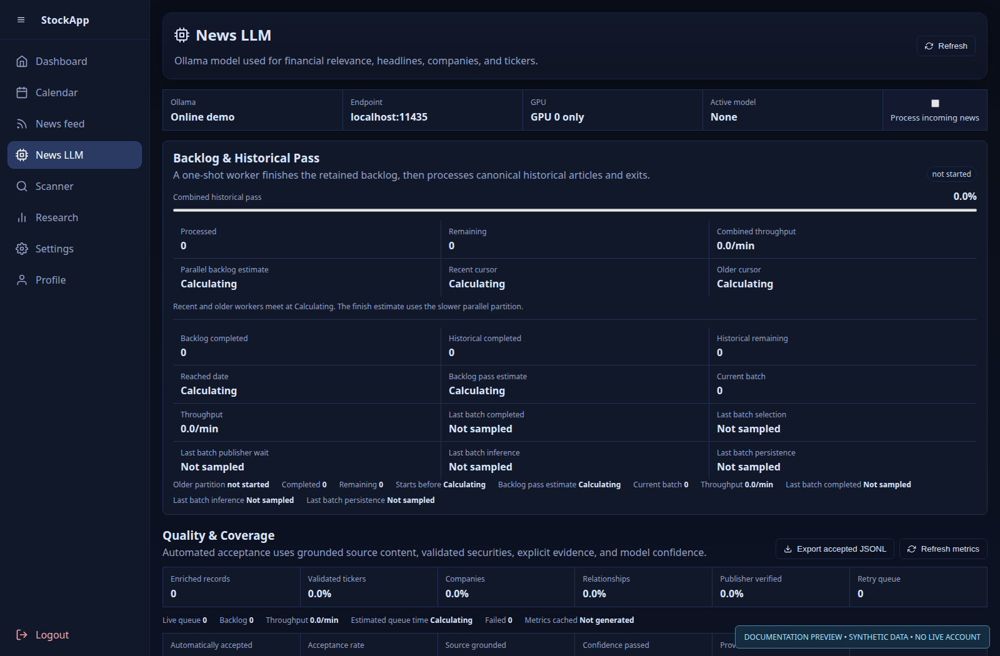

### 2.7 Research / RL Models

**Route:** `/research` · **Purpose:** inspect research inputs and preparation progress.

| Tab | What it reports | What it does not establish |
| --- | --- | --- |
| Live Level 2 | Stream capture, subscribed symbols, observation counts, queue depth, errors, dropped observations, and book freshness | That an RL learner has been deployed or is placing orders |
| 1-minute model | Historical news export, price acquisition, and session assembly status | That a prepared dataset has completed training or passed evaluation |

Use capture health to identify missing or stale observations. Use preparation status to distinguish time spent collecting prices from time spent assembling symbol-day sessions. Historical replay, shadow evaluation, and training utilities live in the backend and have their own prerequisites.

The current Live Level 2 page explicitly presents the learner as not deployed and the learning stages as pending. Research outputs and model scores are not evidence of profitable trading.

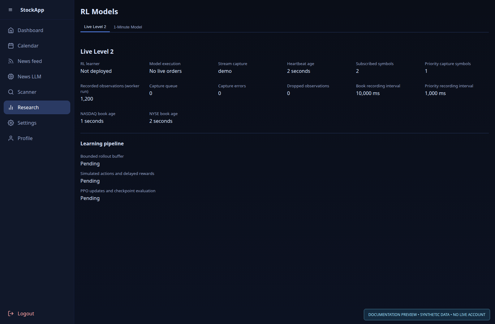

<details>
<summary>1-minute model data preparation</summary>

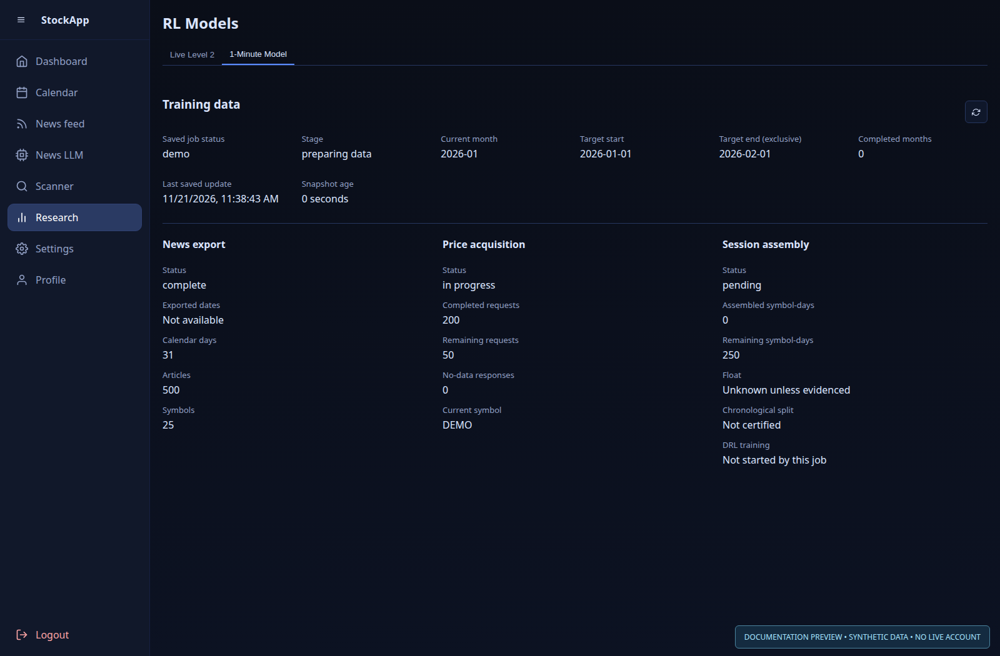

</details>

### 2.8 Settings

**Route:** `/settings` · **Purpose:** maintain the scanner's saved preferences.

Set minimum/maximum price, RVOL threshold and reference window, maximum float shares, and scan interval. Save the form and check its validation or success message. These settings determine the scanner's filtering behavior; changing them does not place an order.

The backend persists saved preferences. Environment variables provide initial defaults, while saved application settings can differ from those defaults. Use this page when tuning the scanner rather than assuming an edit to an environment file has replaced saved settings.

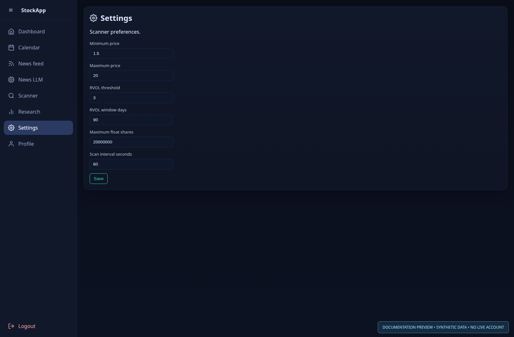

### 2.9 Profile

**Route:** `/profile` · **Purpose:** inspect connection health and manage retained access.

The status cards report Schwab session lifetime, Auto Trader mode and credential status, scanner/news worker heartbeats, and local exit readiness. Refresh the page's status when diagnosing stale data or a blocked dependency. The local-exit card helps identify whether the stream, exit workers, or database journal are available.

Use **Disconnect Schwab** to remove this application's session and retained trading credentials. Ordinary logout can retain trading credentials when Auto Trader is on, so logout and disconnect have different consequences. Neither a browser logout nor closing the browser should be treated as proof that background processes have stopped.

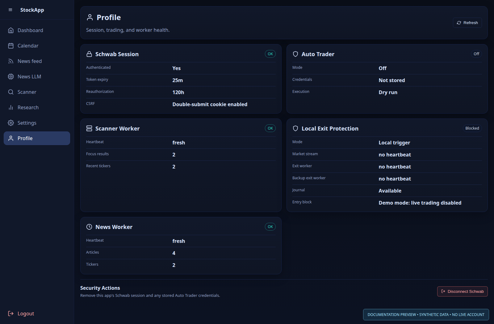

## 3. How the system works

The browser presents account and research information. The API handles authenticated requests, while separate workers collect and process data in the background. Shared storage lets those workers continue operating when a page is closed and lets the UI display their latest results.

### 3.1 Architecture

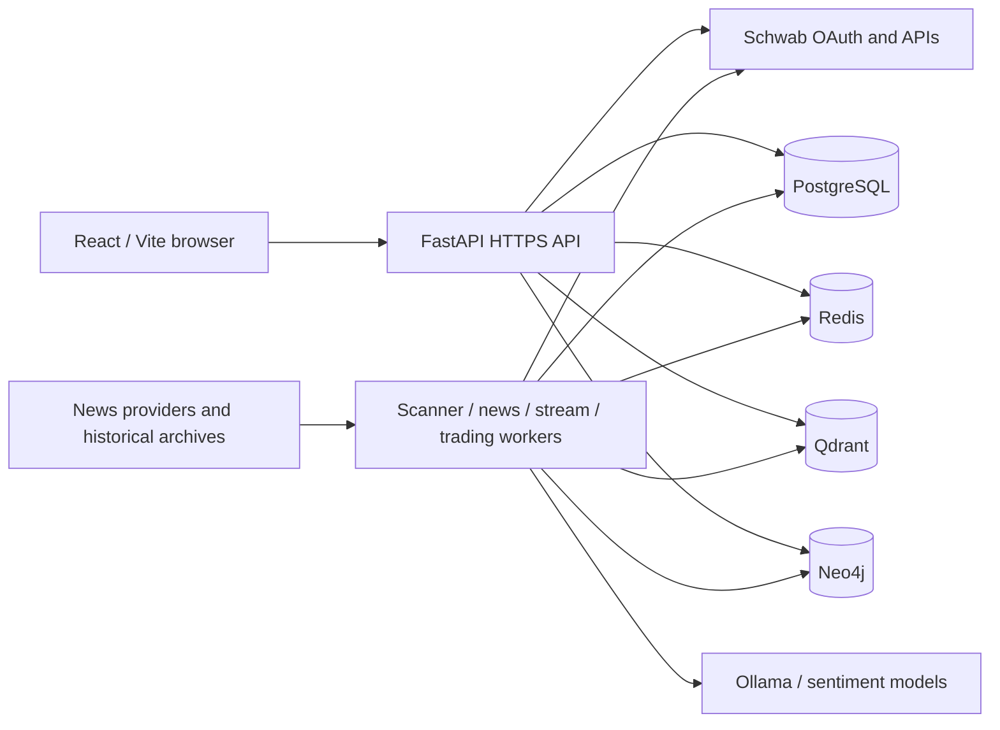

| Layer | Purpose |
| --- | --- |
| React 19, Vite, React Router | Browser interface and navigation |
| TradingView Lightweight Charts | Candlestick and indicator visualization |
| FastAPI / Python | Authentication, portfolio, scanner, news, research, and calendar APIs |
| PostgreSQL | Durable application records, settings, reviews, decisions, and research data |
| Redis | Sessions, encrypted token storage when configured, queues, caches, and heartbeats |
| Qdrant | Article and historical event vector search |
| Neo4j | Company and article relationship graph |
| Ollama and sentiment service | Optional local article analysis and sentiment workflows |
| Docker Compose | Service builds, networking, persistence, and workers |

A page refresh normally asks FastAPI for a current response or saved snapshot. It does not start a new historical import or train a model. Background workers run on their own schedules and publish results/status that the API can return. This separation is why the frontend can be healthy while a particular news or research panel has no data.

### 3.2 Authentication and account access

The OAuth flow establishes permission without storing your brokerage password in the application:

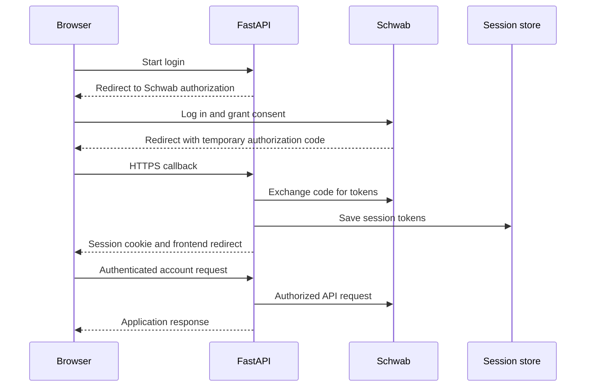

The browser carries a session cookie; backend code uses the Schwab tokens. The configured Fernet key protects stored token blobs. Token refresh can maintain access within the authorization lifetime, but eventual reauthorization still requires Schwab login/consent.

Market-data workers can use the active authorized session. Auto Trader additionally supports retained trading credentials for background operation. Session expiry, retained credentials, and permission to submit orders are separate states, which Profile and the trading controls help expose.

### 3.3 Market data and scanner decisions

There are two complementary data paths:

- **Request/response:** portfolio and chart routes request account information, quotes, and price history for the browser.
- **Background streaming:** the account stream worker subscribes to account/market updates, normalizes incoming messages, maintains recent market state, and records observations for research. Account activity can reach the browser through `/ws/acct`.

The scanner worker assembles candidate symbols, retrieves market/company context, applies configured filters, and evaluates technical and news-related evidence. Its decision logic considers factors such as price, relative volume, float evidence, momentum, catalyst type, and risk/reward. Results and decision history become API responses for Scanner and related views.

A scanner classification is an intermediate result. Actual execution has separate authorization, risk, data-freshness, and worker-readiness checks. Stale quotes, absent float evidence, or missing news context can limit what a decision means even when the page renders successfully.

### 3.4 News ingestion and analysis

The news pipeline turns incoming coverage into searchable context through several stages:

1. **Collect:** enabled providers, RSS sources, and configured historical archives supply articles or event records.
2. **Normalize and consolidate:** publisher URLs and conservative article fingerprints help combine duplicate article coverage while retaining source attribution.
3. **Enrich:** configured workers assess relevance, resolve article content, and attach supported company/ticker context. Local model processing and financial sentiment are distinct steps.
4. **Store and index:** durable records support feeds/reviews, Qdrant supports vector retrieval, and Neo4j connects companies and articles.
5. **Serve:** the API returns recent news, historical event matches, related coverage, and context for scanner/chart/calendar workflows.

Retrieval-augmented generation (RAG) means retrieving relevant stored evidence before optional model synthesis. Retrieval can work without a synthesis model; a generated explanation still depends on the quality and coverage of its sources.

Historical GDELT events remain a separate collection from consolidated publisher articles. Queues, checkpoints, retry handling, and worker heartbeats support long imports and recovery. A running news service does not mean its historical backlog has finished.

### 3.5 Storage and persistence

The stores serve different purposes rather than holding interchangeable copies of the same data:

| Store | Examples of state | Operational implication |
| --- | --- | --- |
| PostgreSQL | Saved scanner settings/results, decisions, calendar reviews/plans, research records and journals | Preserve it for durable application history |
| Redis | Sessions/token blobs, recent market state, caches, queues/cursors, and heartbeats | Expiry or loss can require reauthorization or rebuilding recent operational state |
| Qdrant | Search vectors for articles and canonical events | Search depends on populated indexes; rebuilding requires source data and processing time |
| Neo4j | Security/company relationships and article links | Graph-backed company context depends on this store |
| Local files / volumes | Model weights, archives, datasets, certificates, and progress artifacts | These are machine-specific dependencies and are not shipped with the source |

API startup initializes the application schema; fresh PostgreSQL containers also run `postgres/init.sql`. Browser calendar state supplements server persistence. Stopping containers preserves configured storage, while deleting volumes or local directories can remove it.

Backups of these stores can contain account information, authorization material, and private notes. Keep them outside the public repository and retain the token-encryption key privately if restoring encrypted sessions.

### 3.6 Research and trading boundaries

Data collection, dataset preparation, replay/training, and live execution are separate stages. Recording observations creates research inputs; it does not automatically deploy a model. The Research page reports the stage actually represented by its data.

This code includes order-placement paths. A research dashboard, shadow simulation, and live brokerage execution are different operating modes.

- Start with all live-submission flags shown in the installation section set to `false`.
- The Dashboard Auto Trader switch controls retained trading authorization; it is not the only execution gate.
- When Auto Trader is on, UI logout can retain encrypted trading credentials for background workers. Closing the tab does not stop those workers.
- When Auto Trader is off, logout removes persisted trading credentials. Profile's Disconnect Schwab explicitly removes the app session and retained trading credentials.
- Local exit protection depends on healthy streams, databases, and workers. Do not assume local monitoring is equivalent to a broker-held protective order.
- Shadow/replay results and model scores do not establish future performance. The Live Level 2 learner is not currently presented as deployed.

Read [automated momentum trading](docs/system-guide.md) before considering live execution. This README does not instruct you to enable live trading.

Useful authenticated status routes include `/auth/status`, `/auth/trading`, `/scanner/status`, `/news/status`, `/agent/stop-loss/status`, `/agent/local-exit-readiness`, `/agent/actions/recent`, and `/agent/executions/recent`. Account activity is available through `/ws/acct`.

### 3.7 Services and deployment options

The starter includes `api`, `frontend`, `db`, `redis`, `neo4j`, and `qdrant`. The optional `scanner` profile adds `scanner_worker` and `account_stream_worker`. It does not require GPU devices, archive mounts, or pre-existing named volumes.

The source also contains news ingestion, calendar integration, Ollama management, sentiment analysis, historical import, replay/training, and trading worker modules. These advanced modules are not automatically started or fully deployed by the starter. Consult the [source guide](docs/system-guide.md), supply your own datasets/models/provider access, and design a separate deployment before using them.

Do not infer that every screen is fully populated because the core services are healthy. Data collection, model inference, historical preparation, and order execution have separate requirements.

### 3.8 Source layout

```text
stock-chart-app/
├── backend/                 # API, Schwab integration, services, workers, tests
│   ├── .env.example         # Public configuration template
│   ├── drl_agent/           # Experimental training/replay/data tools
│   ├── routers/            # HTTP and WebSocket routes
│   └── workers/            # Background processing
├── frontend/                # React application and frontend tests
├── postgres/                # Database image and initial schema
├── docs/                    # Feature guides and synthetic screenshots
├── nginx/                   # Reverse-proxy configuration
├── .starter/                # Generated private configuration and TLS files (ignored)
└── compose.starter.yaml
```

Start in `frontend/src/pages/` to understand a screen, `backend/routers/` for its HTTP interface, and `backend/services/` for shared behavior. Long-running work is in `backend/workers/`; the experimental data/training tools are in `backend/drl_agent/`. `compose.starter.yaml` ties the included processes to their environment, dependencies, and storage.

## 4. Operation, development, and publication

### 4.1 Service commands

```bash
docker compose --env-file /dev/null -p stockapp-starter -f compose.starter.yaml --profile scanner ps
docker compose --env-file /dev/null -p stockapp-starter -f compose.starter.yaml logs --tail=100 api frontend
docker compose --env-file /dev/null -p stockapp-starter -f compose.starter.yaml --profile scanner stop
```

Review logs locally before sharing them. Stopping preserves data. Removing volumes can delete database/index/session state. These commands target only the starter project.

### 4.2 Configuration reference

[`backend/.env.example`](backend/.env.example) is the detailed template. `compose.starter.yaml` also supplies explicit overrides; those take precedence over values in its backend env file.

| Variables | Purpose |
| --- | --- |
| `SCHWAB_CLIENT_ID`, `SCHWAB_CLIENT_SECRET`, `SCHWAB_REDIRECT_URI` | Your developer app and callback |
| `SCHWAB_AUTH_URL`, `SCHWAB_TOKEN_URL`, `SCHWAB_PREFERENCES_URL` | Schwab endpoints; defaults supplied |
| `SCHWAB_ACCOUNT_NUMBER` | Optional private account selection; never commit a real value |
| `FRONTEND_URL`, `CORS_ALLOW_ORIGINS` | Frontend return URL and allowed browser origin |
| `SESSION_COOKIE_*`, `CSRF_COOKIE_NAME`, `CSRF_HEADER_NAME` | Session/cookie and CSRF configuration |
| `REDIS_TOKEN_ENC_KEY` | Private Fernet key for token encryption |
| `REDIS_URL`, `DATABASE_URL`, `NEO4J_URL` | Internal service connections |
| `QDRANT_URL`, `QDRANT_NEWS_COLLECTION`, `QDRANT_GDELT_EVENT_COLLECTION` | Vector service and canonical collection names; supplied in Compose |
| `FINNHUB_API_KEY`, `NEWSAPI_KEY`, provider enable flags | Optional paid/free news integrations according to provider terms |
| `GDELT_*` | Event ingestion, archive handling, catch-up, retries, and backfill |
| `NEWS_OLLAMA_URL`, `NEWS_LLM_DEFAULT_MODEL`, `CALENDAR_LLM_*` | Model service and enrichment configuration |
| `RAG_LLM_*`, `OPENAI_*` | Optional remote synthesis configuration; not required for the basic UI |
| `PRICE_MIN`, `PRICE_MAX`, `RVOL_THRESHOLD`, `FLOAT_MAX`, `SCAN_INTERVAL` | Initial scanner defaults; UI settings are persisted separately |
| `AGENT_*`, `SCHWAB_STREAM_*`, `SHADOW_*` | Execution gates, risk settings, streams, and synthetic evaluation |
| `VITE_API_BASE` | Frontend API URL, `https://127.0.0.1:18443` in the starter |

Never put a secret in a `VITE_` variable: frontend configuration is delivered to the browser. Keep API keys and brokerage credentials server-side.

### 4.3 Development and testing

See [TESTING.md](TESTING.md) for isolated test commands and validation limits. From `frontend/`:

```bash
npm ci
npm run test -- --run
npm run lint
npm run build
```

For frontend development against the starter API, preserve its approved origin and use its certificate files:

```bash
VITE_API_BASE=https://127.0.0.1:18443 VITE_CSRF_COOKIE_NAME=stockapp_starter_csrf VITE_TLS_CERT_FILE=../.starter/certs/server.crt VITE_TLS_KEY_FILE=../.starter/certs/server.key npm run dev -- --host 127.0.0.1 --port 13000 --strictPort
```

Run that command from `frontend/` after stopping the starter frontend container to free port 13000. Do not change your working installation's environment to run these checks.

The [screenshot guide](docs/screenshots.md) explains the synthetic browser capture. It blocks live backend traffic and does not require Schwab credentials.

### 4.4 Troubleshooting

| Symptom | What to check |
| --- | --- |
| OAuth callback rejected | Approved app status; exact HTTPS IP, port, and `/auth/callback` path |
| Login loop / failed fetch | Trust both local HTTPS origins; keep frontend URL, CORS, cookies, and API base aligned |
| Authorization expires | Reconnect through Schwab; check Profile's reauthorization timer |
| Cannot decrypt saved tokens | Restore the original encryption key or reauthorize with the new key |
| Scanner has no results | Worker credentials/heartbeat, market-data permissions, filters, and fresh input data |
| Empty news/history search | Ingestion/index workers, provider flags/keys, imported archives, and Qdrant collections |
| News LLM unavailable | Model server health, installed model, service URL, NVIDIA runtime/device IDs, available memory |
| Missing starter state | Initialize a new `.starter` directory; the starter creates its own named volumes |
| Worker image missing | Re-run the explicit starter command with `--profile scanner --build` |
| Advanced feature is unavailable | The starter only deploys core services and optional scanner/stream workers |
| Frontend/API port already in use | Check ports 13000/18443; a previous starter may already be running |
| Research shows pending/not deployed | Dataset preparation and live learner implementation/deployment are separate stages |

Do not paste raw environment files, OAuth URLs, account payloads, or unreviewed logs into GitHub issues. Use synthetic reproductions.

### 4.5 Publishing safely on GitHub

Publish only reviewed source, public templates, documentation, and synthetic images. Do not upload a ZIP of your working installation. `.starter`, real environment files, credentials, keys, datasets, and personal notes belong outside the public repository.

Use the [publication guide](docs/publishing.md). The publication guard checks known private paths and credential patterns; it cannot detect every form of personal information. Ignore rules do not remove tracked files or old commits. A clean export avoids carrying the working repository's history.

No license is selected by this README. Choose an appropriate project license before granting reuse rights. Provider data, articles, and model weights have their own terms and are not included here. Authenticated developer-portal snapshots and local operational reports are excluded.

### 4.6 Further documentation

- [Separate starter installation](docs/starter-setup.md)
- [Schwab integration and official references](docs/schwab-integration.md)
- [Advanced source and system guide](docs/system-guide.md)
- [Testing and validation scope](TESTING.md)
- [Synthetic screenshot capture](docs/screenshots.md)
- [Publication workflow](docs/publishing.md)
